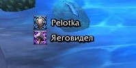
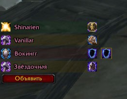

# PallyMaster

Аддон для **World of Warcraft 3.3.5a (WotLK)** для паладинов и рейд-лидеров:
показывает ауры паладинов группы и рейда и помогает распределять баффы
между ними. Один аддон, два модуля, одно окно настроек.

## Возможности

**Ауры.** Строка — одна аура, в ней иконка и ники всех паладинов, которые
наложили её сами. Паладины без поддерживаемых аур собираются в строку
«Без ауры». Поддерживаются самоотверженность, воздаяние, сосредоточенность,
сопротивление тьме, магии льда и магии огня, воин Света. Ники можно красить
белым, по классу или по ауре, полоске — задать цвет из палитры и прозрачность.

**Баффы.** Строка на каждого паладина: специализация, ник и назначенные
баффы. Клик по строке открывает меню, где бафф назначается или снимается.
Доступны Каска, Кулак, Мудрость и Прото; Прото может взять только паладин
в спеке защиты. Специализация определяется автоматически — по книге
заклинаний, талантам, аурам и инспекту. Кнопка «Объявить» отправляет
назначения в чат: в рейде через `/rw`, если есть права, иначе в рейд или
группу; вне группы — только локально.

**Общее.** Обе полоски настраиваются одинаково: ширина, масштаб, отступ,
иконки, шрифт, прозрачность, цвет, скрытие в бою, режим «только в группе
и рейде» и закрепление позиции. Высота подстраивается под иконку и шрифт.

## Установка

1. Папку `PallyMaster` поместить в `<путь к WoW>\Interface\AddOns\`
2. Перезапустить клиент или выполнить `/reload`.

## Команды

Все команды начинаются с `/pm`.

| Команда | Действие |
|---|---|
| `/pm` | открыть или закрыть настройки |
| `/pm auras` / `/pm buffs` | открыть нужную вкладку |
| `/pm lock` / `/pm unlock` | закрепить или разблокировать позицию |
| `/pm reset` | сбросить настройки |
| `/pm announce` | объявить назначенные баффы |
| `/pm announcetest` | показать в чат план объявления, ничего не отправляя |
| `/pm whoami` | показать состав и права на `/rw` |
| `/pm refresh` | переинспектировать паладинов |
| `/pm debug` / `/pm inspectdebug` | отладочный вывод |

## Зависимости

Библиотеки (`LibStub`, `CallbackHandler-1.0`, `LibTalentQuery-1.0`,
`LibGroupTalents-1.0`) уже лежат в `Libs`. Без них аддон работает, но
специализация определяется менее точно.

## Лицензия

MIT — см. [LICENSE](LICENSE).
